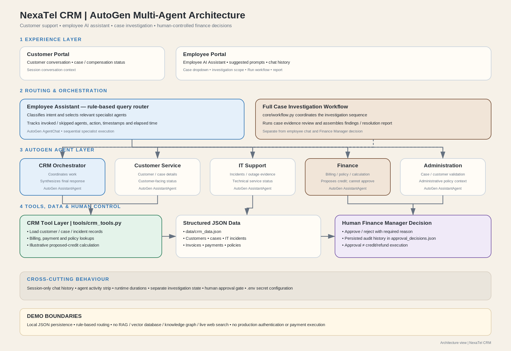
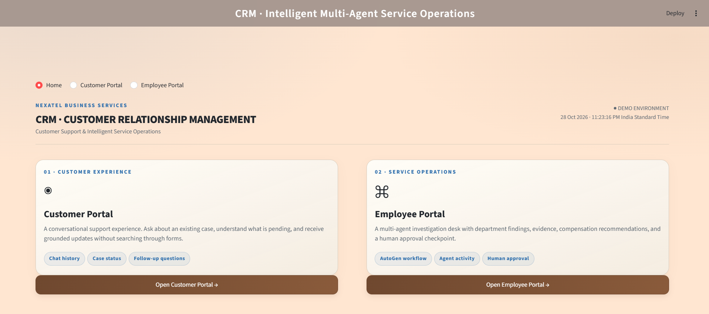
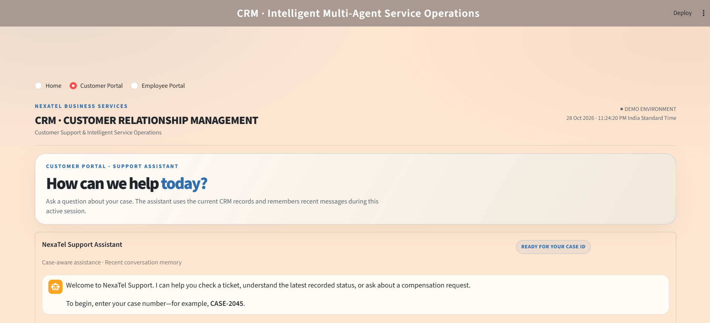
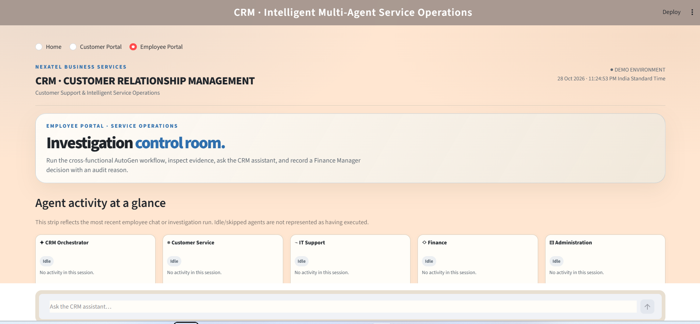
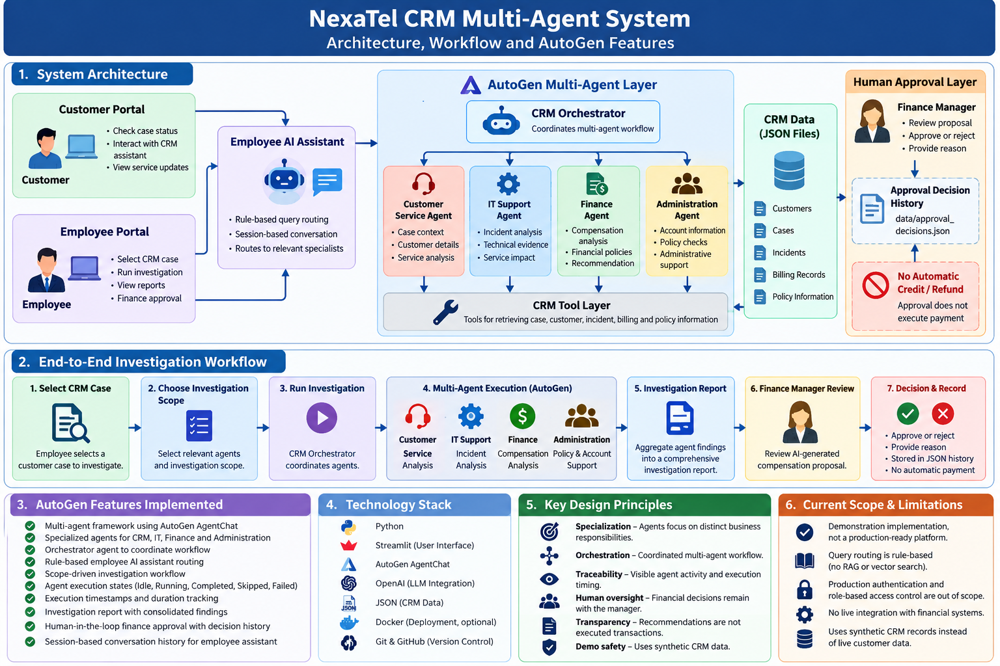

# NexaTel CRM — AutoGen Multi-Agent Customer Support

NexaTel CRM is a Streamlit demo for customer support and service operations. It combines structured CRM data, AutoGen agents, an employee AI assistant, a full case investigation workflow, and a human-controlled Finance Manager decision process.

## Architecture



The diagram is stored in this repository at `docs/images/crm_autogen_architecture.png`. The editable SVG version is at `docs/images/crm_autogen_architecture.svg`, and the Mermaid source is at `docs/architecture.mmd`.

## Implemented features

### Customer Portal
- Chat-style customer interaction with session-level conversation history.
- Answers based on local CRM records and relevant saved decision history.
- Separates case status, technical incident status, compensation decision status, and transaction status where relevant.

### Employee Portal
- CRM case dropdown and investigation-scope dropdown.
- Run Workflow action for full case investigation.
- Employee AI Assistant with suggested questions, including:
  - What are the critical cases?
  - What are the critical incidents?
  - What is the status of CASE-2045?
  - Which cases need Finance Manager approval?
- Rule-based query routing to relevant specialist agents.
- Horizontal activity strip for all five agents: CRM Orchestrator, Customer Service, IT Support, Finance, and Administration.
- Agent activity state, action, timestamps, and elapsed duration where provided by actual runtime execution.
- Employee chat history is separate from investigation results and persisted Finance Manager decisions.

### AutoGen multi-agent workflow
- CRM Orchestrator coordinates/synthesizes the agent response where configured.
- Customer Service Agent handles customer and case context.
- IT Support Agent handles incident and outage evidence.
- Finance Agent handles billing/policy context and illustrative proposed-credit calculation.
- Administration Agent handles case/customer validation and administrative context.
- Selected agents are invoked sequentially in the current design.
- Full case investigation remains separate from lightweight employee chat.

### Finance Manager decision controls
- Approve/reject is a separate human action.
- Reviewer identity and reason are required by the decision form.
- Decisions are persisted in `data/approval_decisions.json`.
- Approval is not represented as proof that a credit/refund was executed.
- The demo does not execute real payments, credits, or refunds.

### Data and safeguards
- Structured data is read from `data/crm_data.json`.
- Case records and IT incident records are separate entities linked by `case_id`.
- Local JSON persistence is intended for a demo, not concurrent production use.
- `.env` stores the OpenAI API key and must not be committed.

## Architecture and design documents

- [Detailed design](docs/DESIGN.md)
- [Architecture diagram (PNG)](docs/images/crm_autogen_architecture.png)
- [Architecture diagram (SVG)](docs/images/crm_autogen_architecture.svg)
- [Editable Mermaid source](docs/architecture.mmd)

## Project structure

```text
crm-multi-agent-system/
├── app.py
├── agents/
│   └── agent_factory.py
├── core/
│   └── workflow.py
├── tools/
│   └── crm_tools.py
├── data/
│   ├── crm_data.json
│   └── approval_decisions.json
├── docs/
│   ├── DESIGN.md
│   ├── architecture.mmd
│   └── images/
│       ├── crm_autogen_architecture.png
│       └── crm_autogen_architecture.svg
├── .env
├── requirements.txt
└── README.md
```

This is a reference structure; retain any additional files and folders already present in the working project.

## Prerequisites

- Python 3.12 recommended for the current development environment.
- OpenAI API key configured locally.
- Virtual environment.

## Setup (Windows CMD)

Run from the project root:

```cmd
.venv\Scripts\activate.bat
python -m pip install -r requirements.txt
python -m streamlit run app.py
```

If creating a fresh environment:

```cmd
python -m venv .venv
.venv\Scripts\activate.bat
python -m pip install --upgrade pip
pip install -r requirements.txt
```

Create `.env` locally with the API key variable expected by the code (commonly `OPENAI_API_KEY`). Never commit the real key.

## Suggested validation before freezing

1. Ask `What are the critical cases?`
2. Ask `What are the critical incidents?`
3. Ask `What is the status of CASE-2045?`
4. Ask `Which cases need Finance Manager approval?`
5. Run the full investigation for `CASE-2045`.
6. Confirm all five agent cards reflect actual execution; skipped agents must not be marked completed.
7. Test an unknown ID such as `CASE-9999`.
8. Verify reviewer/reason validation and decision persistence after restarting Streamlit.
9. Confirm `.env` and secrets are excluded from Git.
10. Install `requirements.txt` in a clean environment and launch the application.

## Current limitations

- Routing is rule-based; this is not an autonomous planner.
- CRM retrieval uses structured local JSON, not RAG/vector search or a knowledge graph.
- No live web search is implemented.
- No production authentication or role-based access control is included.
- Reviewer identity is self-entered in the demo.
- No real financial transaction is executed.
- Runtime status/timing must be verified against the running application before release freeze.

## Release status

Treat the application as a demo candidate until the regression checklist passes. After verification, commit the code and documentation together and tag the tested baseline (for example, `v1.0.0-demo`).


---

## 🖥️ Application Screenshots

### 1. NexaTel CRM — Home Page

The landing page introduces the NexaTel CRM application and its intelligent multi-agent service operations.



### 2. Customer Portal

The Customer Portal enables customers to interact with the CRM assistant, check case status, and review service-related updates.



### 3. Employee Portal

The Employee Portal provides access to case investigations, multi-agent workflow execution, investigation reports, and finance approval processes.



---


---

## 🏗️ CRM Project Architecture & Workflow

The following visual summarizes the NexaTel CRM Multi-Agent System architecture, end-to-end investigation workflow, AutoGen capabilities, technology stack, design principles, and current implementation boundaries.



### Architecture Highlights

- **Multi-agent orchestration:** AutoGen coordinates specialized CRM, Customer Service, IT Support, Finance, and Administration agents.
- **Intelligent employee assistance:** Rule-based routing directs employee queries to relevant specialists.
- **Investigation workflow:** Employees select a CRM case and investigation scope, execute the workflow, and review consolidated findings.
- **Execution visibility:** Agent status, timestamps, and execution durations support workflow traceability.
- **Human-in-the-loop governance:** A Finance Manager approves or rejects compensation proposals and records a reason.
- **Persistent decision history:** Finance decisions are stored in `data/approval_decisions.json`.
- **Demo-safe design:** Synthetic CRM data is used, and approval does not trigger an actual credit or refund.

### Implementation Boundaries

This is a demonstration application. Employee query routing is rule-based; RAG, vector search, production authentication, role-based access control, and live financial integrations are outside the current scope.

---


**Note:** This demonstration uses synthetic CRM data. Finance decisions require human approval, and actual credit or refund transactions are not executed by the application.
